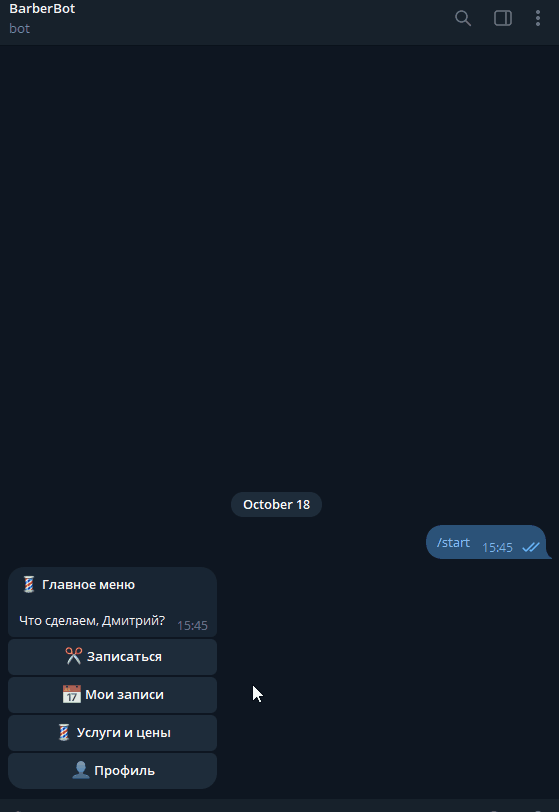
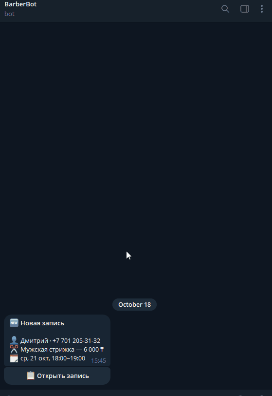
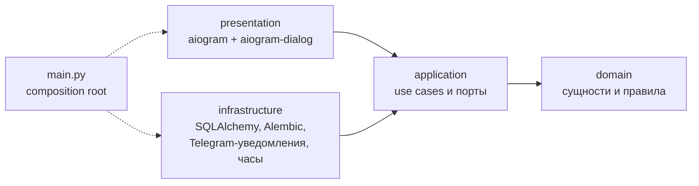

# barber-bot

[](https://github.com/olzhasraxmetov-lgtm/tg_barber_bot/actions/workflows/ci.yml)


Telegram-бот онлайн-записи к одному мастеру-барберу. Клиент записывается в несколько нажатий
и получает напоминание. Мастер видит расписание дня и узнаёт о каждой записи, отмене и переносе.
Переписываться для согласования времени больше не нужно.

| Клиент: запись | Мастер: уведомление и расписание |
|:---:|:---:|
|  |  |

## Что умеет

**Клиент**

- Регистрация в два шага: имя из Telegram (или своё) и кнопка «📱 Поделиться контактом».
- Запись: услуга → календарь, где можно нажать только на доступные даты → свободное окно →
  подтверждение. Если окно успели занять, бот скажет об этом и вернёт к выбору времени.
- «Мои записи»: отмена и перенос не позднее чем за 3 часа до начала.
- Напоминание за 24 часа с кнопками «✅ Приду», «Перенести», «Отменить».

**Мастер**

- Сразу узнаёт о новых записях, отменах, переносах и подтверждениях визита. В 9:00 получает
  сводку дня.
- Расписание на сегодня, завтра или любую дату. В карточке записи можно отменить её с
  причиной или отметить неявку.
- Ручная запись за клиента без Telegram. Если клиент потом придёт в бот с тем же телефоном,
  записи склеятся, и он начнёт получать напоминания.
- Недельный график и исключения: закрытые дни или изменённые часы. Если изменение задевает
  существующие записи, бот покажет их и спросит, отменить ли их.
- Услуги: название, цена, длительность, скрыть или вернуть. Цена и длительность в уже
  созданных записях не меняются.
- «Режим клиента» позволяет пройти путь клиента с того же аккаунта.

Правила записи: сетка 30 минут, горизонт 30 дней, обед 13:00–14:00, минимальный запас до
начала 3 часа. Это константы в [`domain/rules.py`](src/barber_bot/domain/rules.py).

## Быстрый старт

Понадобятся токен бота от [@BotFather](https://t.me/BotFather) и ваш Telegram ID. ID можно
узнать у [@userinfobot](https://t.me/userinfobot). Аккаунт с этим ID становится мастером.

```bash
git clone https://github.com/olzhasraxmetov-lgtm/tg_barber_bot.git && cd tg_barber_bot
cp .env.example .env        # вписать BOT_TOKEN и MASTER_TELEGRAM_ID
docker compose up -d --build
```

Или без Docker, через [uv](https://docs.astral.sh/uv/):

```bash
uv sync
uv run bot
```

При старте бот сам применяет миграции. Если база пустая, он добавляет демо-услуги и график:
Пн–Пт 10–20, Сб 11–18. Записаться можно сразу. Демо-данные отключаются через `SEED_DEMO=false`.
Остальные настройки (часовой пояс, валюта, путь к базе) описаны в [`.env.example`](.env.example).

## Архитектура

Чистая архитектура, зависимости направлены только внутрь ([ADR 0002](docs/adr/0002-clean-architecture.md)):



| Слой | Что внутри |
|------|------------|
| [`domain`](src/barber_bot/domain) | Сущности и чистые правила: подсчёт свободных окон, правила отмены и переноса, время напоминания. Без внешних зависимостей. |
| [`application`](src/barber_bot/application) | Use cases клиента, мастера и фоновых задач. Порты: репозитории, Unit of Work, часы, уведомления. |
| [`infrastructure`](src/barber_bot/infrastructure) | SQLite через SQLAlchemy 2 async, миграции Alembic, отправка уведомлений в Telegram, конфиг из `.env`. |
| [`presentation`](src/barber_bot/presentation) | Диалоги aiogram-dialog. Тонкий слой: только вызывает use cases. Все тексты бота лежат в [`texts.py`](src/barber_bot/presentation/texts.py). |

Решения, которые стоит знать:

- **Двойную запись исключает схема БД, а не проверка в коде.** Запись занимает строки по
  30 минут в таблице шагов сетки с `UNIQUE` по времени начала. Конфликт вставки означает
  «окно уже занято» ([ADR 0001](docs/adr/0001-sqlite-and-grid-cell-locking.md)).
- **SQLite, а не Postgres.** Бот работает одним процессом на одного мастера. Бэкап — это копия файла.
- **Время приходит через порт часов**, а не через `datetime.now()`. Поэтому правила «3 часа» и
  «24 часа» тестируются детерминированно.
- **Фоновые задачи** (напоминания и сводка дня) — цикл раз в минуту. Отметки об отправке
  хранятся в базе, поэтому после перезапуска ничего не дублируется и не теряется.

Термины предметной области собраны в глоссарии [`CONTEXT.md`](CONTEXT.md).

## Тесты и проверки

Тесты двух уровней:

- `tests/domain` — чистый домен без I/O: свободные окна, обед, исключения, горизонт, граница
  «ровно 3 часа», время напоминания.
- `tests/application` — use cases на настоящем SQLite. Схема поднимается миграциями Alembic до
  head, часы и отправка уведомлений подставные. Проверяются гонка за окно, перенос, конфликты
  графика, склейка клиентов, однократность напоминаний и сводки.

```bash
uv run pytest -q
uv run ruff format --check . && uv run ruff check .
uv run mypy                 # strict, src и tests
```

Всё это запускает CI на каждый push и PR: [`.github/workflows/ci.yml`](.github/workflows/ci.yml).

## Стек

Python 3.12 · aiogram 3 · aiogram-dialog 2 · SQLAlchemy 2 (async) + aiosqlite · Alembic ·
pydantic-settings · pytest · ruff · mypy · uv · Docker · GitHub Actions
